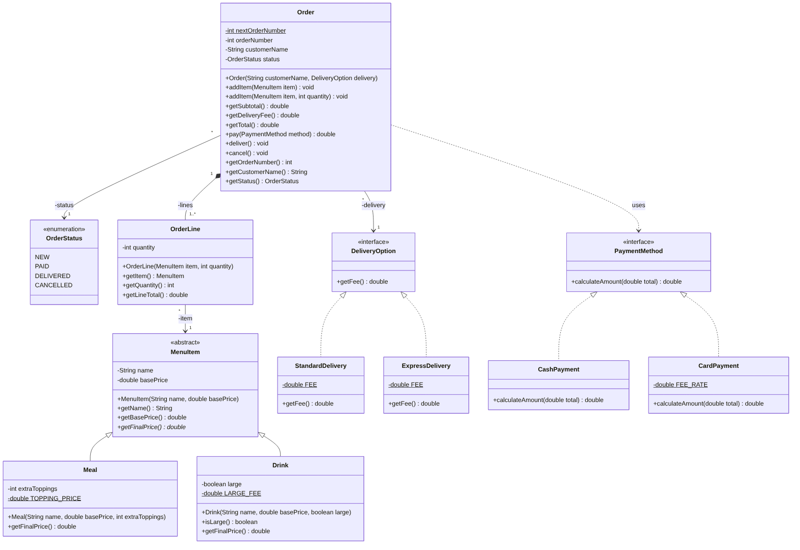

# Food Delivery System - UML Class Diagram

Object-Oriented Design assignment: UML class diagram for a food delivery system.

**Name:** ______________________  
**ID:** ______________________

## Files
- `Food_Delivery_UML_Class_Diagram.pdf` - the final diagram (PDF)
- `Food_Delivery_UML_Class_Diagram.png` - the final diagram (image)
- `food_delivery.mmd` - Mermaid source of the diagram

## Diagram

## Design summary
- `MenuItem` (abstract) with subclasses `Meal` and `Drink`; each overrides `getFinalPrice()`.
- `DeliveryOption` interface, implemented by `StandardDelivery` and `ExpressDelivery`, so new options can be added without changing `Order`.
- `PaymentMethod` interface, implemented by `CashPayment` and `CardPayment`.
- `Order` is composed of one or more `OrderLine` objects; each line refers to a `MenuItem`.
- `OrderStatus` enum: NEW, PAID, DELIVERED, CANCELLED.
- `Order.nextOrderNumber` is static and generates order numbers 1001, 1002, ...
